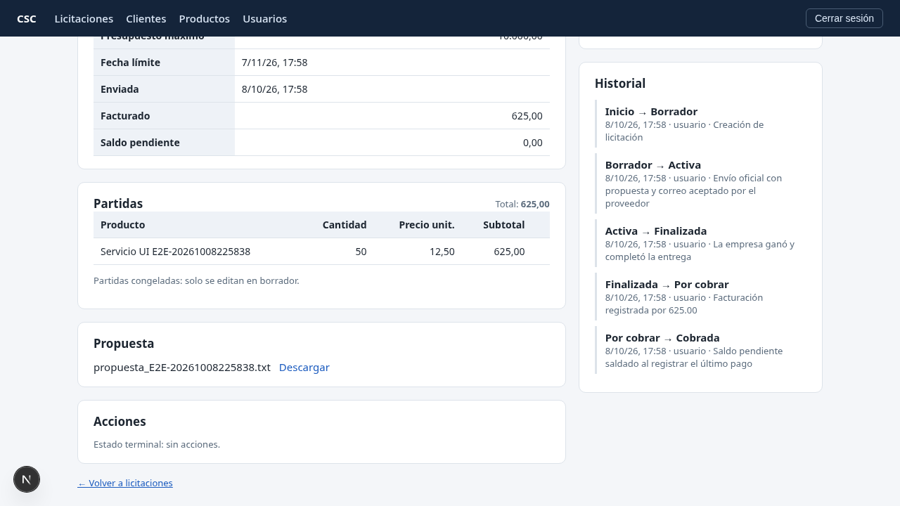

# CSC - Sistema de Gestión de Licitaciones

Gestión de licitaciones de principio a fin: armar la oferta, enviarla
oficialmente por correo, dar seguimiento (ganada/perdida), facturar y
cobrar - con todas las reglas de negocio aplicadas por el propio sistema.

Backend FastAPI + SQLModel + Alembic + PostgreSQL, frontend Next.js,
correo real con Resend (patrón outbox) y propuestas en Supabase
Storage (bucket privado + URL firmada).



## Qué hace (en 30 segundos)

- Arma la oferta como borrador con partidas (productos, cantidades,
  precios) y valida que el total nunca supere el presupuesto (con locks:
  no se rompe con dos pestañas).
- Sube el documento de propuesta y envía oficialmente: correo real al
  cliente con resumen + adjunto, una sola vez (outbox idempotente).
- Recordatorios a 48 h del plazo y pérdida automática al vencer
  (job interno autenticado).
- Resolución ganada/perdida, factura, pagos parciales sin
  sobrepago y cobrada automática al saldar.
- Cada cambio de estado queda en un historial auditable con actor,
  razón y fuente (usuario/sistema).
- Clientes, productos y usuarios gestionables desde la UI; borrado lógico
  de clientes (sus licitaciones se conservan).

## Arranque en 5 minutos

```bash
./scripts/bootstrap.sh --run  # BD + migraciones + seed + backend :8000 + frontend :3000
```

Abrir http://localhost:3000. Credenciales de demo:

| Rol | Correo | Contraseña |
|---|---|---|
| Admin | `admin@example.com` | `CambiaEstaClave1!` (dev; en prod va por `ADMIN_PASSWORD`) |
| Usuario | `ui.demo@csc.dev` | `Uitest123!` |

> Solo un admin crea usuarios. En producción `SECRET_KEY`, `ADMIN_PASSWORD`,
> `RESEND_API_KEY`, `SUPABASE_URL/SERVICE_KEY` y `CRON_SECRET` van en el
> entorno, nunca en el repo (`.env` está en `.gitignore`).

## Desplegado en producción

https://csc-licitaciones.onrender.com - Render (plan free, un solo
origen: API + frontend en un contenedor) + Postgres/Storage en Supabase +
cron externo. Detalles, secrets y runbook en `docs/DEPLOY.md`; evidencias
del entorno desplegado en `docs/evidencias/dia10_desplegado.md`.

El frontend llama al backend por el mismo origen (rewrite de Next), así que
la cookie JWT funciona igual que en local. El Swagger/OpenAPI queda oculto
en producción (regla de seguridad) y visible en dev (`/docs` en local).

## Verificación (evidencia, no "compila = listo")

| Capa | Resultado |
|---|---|
| Backend (pytest sobre PostgreSQL real aislada + migraciones) | 77/77, cobertura ≈ 86 % |
| UI (Playwright, `cd frontend && npm run e2e`) | Flujo feliz 15/15 (borrador -> cobrada) + casos negativos 9/9 (401/403/409/422/404) |
| Email real (smokes Resend) | 20/20 y 16/16 - correos `delivered` (IDs en `docs/REGISTRO_DESARROLLO.md`) |
| Storage real (smoke Supabase) | 11/11 - upload, descarga y URL firmada |
| Tipos | `tsc --noEmit` limpio |

Capturas: flujo feliz en `docs/evidencias/dia10_ui/`, casos negativos en
`docs/revision/capturas/`.

## Cómo probarlo a mano en 4 niveles

1. Navegador: entra con las credenciales demo y recorre el flujo -
  Clientes -> Productos -> Licitaciones (nueva, partidas, propuesta, enviar,
  finalizar, facturar, pagar). El correo de prueba llega a
  `sinidie@proton.me` (único destino del sandbox de Resend; otro correo
  daría 502 en el envío).
2. E2E automático: `cd frontend && npm run e2e` (15/15) y
  `node e2e/ui_flow_neg.mjs` (9/9).
3. Backend: `cd backend && ./venv/bin/python -m pytest tests/ -q`.
4. Integraciones reales: smokes en `backend/scripts/` (correo, storage y
  storage) contra Resend/Supabase de verdad.

> Trampa conocida: no lances `npm run build` mientras `next dev` esté
> activo (comparten `.next/` y rompen el dev con 500).

## Arquitectura y decisiones

Lectura recomendada de 10 minutos: `docs/ARQUITECTURA.md` - las piezas
y las decisiones defendibles (matriz de estados con historial en la misma
transacción, locks `FOR UPDATE`, outbox, URL firmada, seguridad por capas,
soft delete).

- `docs/REGISTRO_DESARROLLO.md` - bitácora del proyecto: decisiones, estado,
  evidencias e historial
- `docs/MANUAL_USUARIO.md` - manual para usuarios finales.
- `docs/revision/` - informes de la revisión de calidad (especificaciones,
  código, QA exploratorio).

## Fuera de alcance (decisiones conscientes)

La prueba técnica prioriza un vertical completo y sólido; lo siguiente es
fase expresamente posterior y está razonado en `docs/ARQUITECTURA.md`:
multi-tenant/ownership por comercial, paginación visual del listado,
rate limiting/cron para multi-worker (Redis), CI y remoto git (casi al
final, decisión del usuario). El despliegue -VPS propio o gestionado- está
pendiente de elegir: ver `docs/ARQUITECTURA.md` (Despliegue) y
`docs/DEPLOY.md`.

## Estructura

```
backend/  FastAPI + SQLModel + Alembic (endpoints, services, models, tests)
frontend/  Next.js (App Router, api.ts, e2e Playwright)
scripts/  bootstrap.sh (arranque de cero, idempotente)
docs/  MANUAL_USUARIO.md, ARQUITECTURA.md, revision/, evidencias/
README.md  qué es y cómo arranca · docs/  documentación completa
```

Más detalles de instalación y endpoints en `backend/README.md` y
`frontend/README.md`.